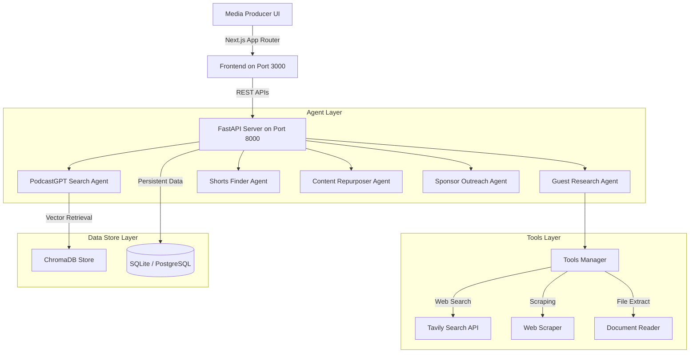

# PodcastOS 🎙️

### The Production-Quality AI Operating System for Modern Podcast Teams

PodcastOS is a modular, high-fidelity AI-driven platform designed to automate guest research, question preparation, transcript search, viral clip detection, and sponsor outreach. Inspired by the workflows of world-class production houses like **Figuring Out Media**, it provides a streamlined internal OS experience for media executives and content managers.

> [!NOTE]
> **Legal Disclaimer:** PodcastOS is an independent portfolio project. It is not officially affiliated with, endorsed by, or partnered with Figuring Out Media, Raj Shamani, or their respective brands.

---

## 🛠️ Tech Stack

- **Frontend:** Next.js (App Router), React, Tailwind CSS (v4), Framer Motion, TypeScript
- **Backend:** FastAPI, Python, Pydantic, SQLAlchemy
- **AI / LLM Orchestration:** Google Gemini API, LangChain
- **Vector Database:** ChromaDB
- **SQL Database:** SQLite (Development) / PostgreSQL (Production)
- **Authentication:** Clerk / Auth.js

---

## 🏗️ System Architecture



---

## ✨ Features (Phases Breakdown)

### Phase 1: MVP (Complete & Fully Functional)
1. **Guest Research Agent:** Automates bio synthesis, career timelines, financial records, industry competitors, and drafts **50 categorized interview questions** (Icebreakers, Contrarian, Future, business, etc.).
2. **PodcastGPT:** Semantic transcript query tool powered by ChromaDB. Search transcripts using natural queries (e.g., *"What did Nikhil Kamath say about option trading?"*) and get back exact quotes, timestamps, and confidence scores.
3. **Viral Shorts Finder:** Analyzes transcripts or video contexts to identify high-retention hooks, predicted viral scores, vertical subtitles, and writes copywriting hooks for TikTok, YouTube Shorts, and Reels.
4. **Knowledge Base:** Upload console supporting PDF, DOCX, TXT, CSV, and Markdown. Automatic extraction, chunking, and embedding.
5. **Dashboard:** Unified command console featuring usage metrics, token parameters, estimated API cost trackers, and recent activity logs.

### Phase 2: Engagement & Partnerships (Fully Functional)
1. **Content Repurposer:** Repurposes raw transcript segments into LinkedIn posts (with custom tone styles: Naval, Alex Hormozi, Raj Shamani, Justin Welsh), Twitter threads, carousels, and newsletters.
2. **Sponsor Outreach:** Scrapes sponsor websites, maps consumer demographics, and writes personalized pitch emails, proposal outlines, and ROI briefs.
3. **Prompt Library:** A repository of advanced prompt templates categorized for content strategy, marketing, and sales. Bookmark and favorite templates.

### Phase 3: Advanced Automation (Roadmap)
1. **AI Producer:** Lifecycle manager orchestrating pre-production briefs, scripting, and multi-channel publication scheduling.
2. **Guest Comparison:** Cross-analyzes opinions, business methodologies, and philosophies of multiple guests.
3. **AI Workflow Builder:** Drag-and-drop workflow visualizer.

---

## ⚙️ Installation & Setup

### Prerequisites
- Node.js (v20+ or v24+)
- Python (3.10+)
- npm

### 1. Backend Setup
Navigate to the `backend/` directory:
```bash
# Set up Python virtual environment
python -m venv venv
source venv/bin/activate  # On Windows: .\venv\Scripts\activate

# Install requirements
pip install -r requirements.txt

# Start local server
uvicorn app.main:app --reload --host 127.0.0.1 --port 8000
```
*Note: The SQLite database initializes and pre-seeds itself on startup.*

### 2. Frontend Setup
Navigate to the `frontend/` directory:
```bash
# Install dependencies
npm install

# Start Next.js dev server
npm run dev
```

### 3. Environment Variables
Create a `.env` file in the `backend/` directory:
```env
GEMINI_API_KEY=your_gemini_api_key  # Optional: Defaults to high-fidelity mock Demo Mode
TAVILY_API_KEY=your_tavily_api_key  # Optional: For live web search scraping
DATABASE_URL=sqlite:///./database/podcast_os.db
```

---

## 🔒 Demo Mode & Live Mode

PodcastOS features a **Dual-Mode** execution engine. 
- **Demo Mode (Default):** If `GEMINI_API_KEY` is not present, all agents trigger realistic, highly-detailed mock responses. No API keys are required for offline testing.
- **Live Mode:** Once the key is configured in Settings or `.env`, the system automatically shifts to real-time LLM parsing, live document extraction, and Tavily-driven search loops.

---

## 📄 License

Distributed under the MIT License. See `LICENSE` for more information.
